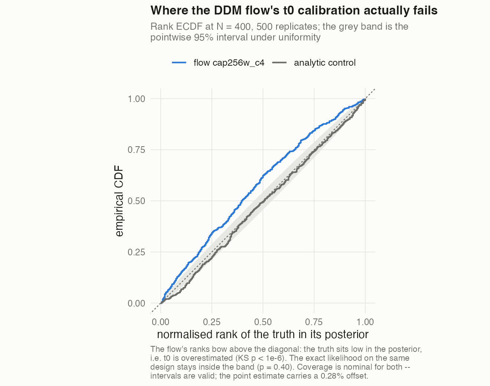
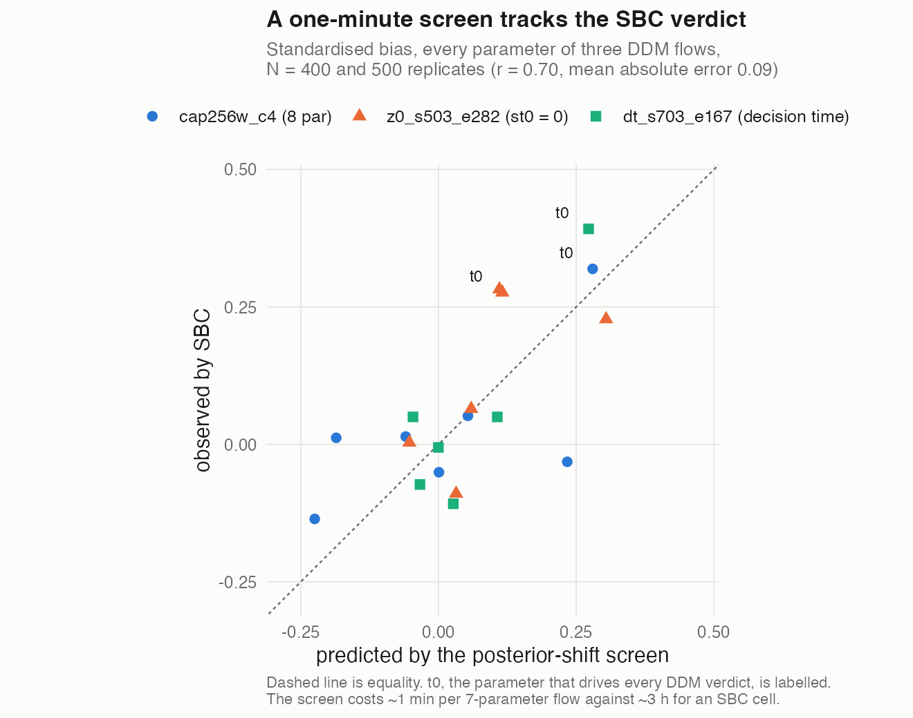

# Calibration-grade neural likelihoods for evidence accumulation models

*Methods document, revised 2026-09-23 after Phase 37 retracted the st0 = 0 and
decision-time SBC verdicts (§3.7). One result is outstanding — the
direct-regression baseline's SBC cell, still running; see §4 and
`docs/OPEN_ITEMS.md`. Companion to `RECIPE.md` (the five steps, condensed),
`TRAPS.md` (the checklist) and `EMC2_INTEGRATION.md` (the how-to). Every number
here is backed by an object under `results/` or, for the dead ends, under
`../long-and-winding-road/`. The full audit trail is `SBC_PLAN.md` in the parent
project (36 phases); phase numbers are cited as (P7), (P33) and so on.*

*Scale convention: every parameter-space quantity is on EMC2's **sampled**
scale unless stated otherwise — `a`, `t0`, `sv`, `st0` are logs, `Z` and `SZ`
are probits. Getting this wrong once cost us a factor of 3.5 on the headline
t0 number (P27).*

---

## 1. Introduction — what a neural likelihood is for, and how it should be judged

A neural likelihood replaces an expensive density `p(rt, R | θ)` with a network
`f̂(rt, R | θ)` trained on simulations. It is worth building only where the
analytic is expensive, and it is worth using only if the posteriors it produces
are the posteriors the true likelihood would produce.

**Where it pays.** Measured on the same designs, single participant:

| model | analytic | flow | verdict |
|---|---|---|---|
| DDM | series with precision control; 68.4 min per SBC cell (N=100, 500 reps) | 37.2 min | flow **4.0–5.8x** faster than EMC2's default-precision analytic, **59–86x** faster than a tight one (P23) |
| RDM | closed-form Wald; 467 µs per 2000 accumulator-rows | 86,667 µs (`rdm_small`) | flow ~185x **slower** (P21c, P21d) |

**And it pays most where the model is fullest.** The seven-parameter DDM has no
LAN in the published library — HSSM's `full_ddm` (v, a, z, t, sz, sv, st) ships a
**blackbox** likelihood only, `hddm_wfpt`'s numerical integration — so that, not a
network, is what our flow replaces at this parameterisation. Milliseconds per
1000 trials, one core, conventions verified against WienR to 4.3e-07
(`evaluation/bench_fullddm.R`):

| setting | HSSM `full_ddm` | WienR 1e-8 | EMC2 default 5e-3 | **our flow** |
|---|---|---|---|---|
| sv .01, SZ .05, st0 .10 (our box floors) | 24.0 | 13.9 | 3.3 | **1.50** |
| sv .50, SZ .20, st0 .20 | 178.0 | 105.2 | 3.6 | **1.25** |
| sv 1.5, SZ .40, st0 .30 | 560.9 | 280.6 | 5.7 | **1.25** |

The integration cost rises 23x across these settings and **the flow's does not
move**: it is 16x to 449x faster than the likelihood HSSM would use, 9x to 225x
faster than a tight analytic, and 2.2x to 4.5x faster than EMC2's default
precision. A neural likelihood's advantage is largest exactly where the model
carries the trial-to-trial variability that makes the density expensive.

Quote that range, not a single multiplier: **the speedup is a function of where
you evaluate it**, and the most honest comparison against everyday practice is
the EMC2-default column, where it is 2-5x rather than hundreds. Against a
published LAN, and on the implementation caveats that a cross-library timing
carries, see §3.8.

The DDM density is an infinite series whose cost scales with the precision
demanded; the flow's cost is fixed. Race models have closed-form first-passage
densities that are already cheap. So the DDM is the speed case, and the RDM
appears here as a **generality demonstration** — that the method transfers to a
model with a different likelihood structure and no choice classifier — not as a
speedup. Say so in the first paragraph of the RDM section, not in a footnote.

**How it should be judged.** Neural likelihoods are usually validated on
held-out log-likelihood, pointwise error, or total mass. For inference those
metrics are close to irrelevant, and this project's central finding is that they
can order models *opposite* to calibration:

- EMC2's default-precision analytic (precision 5e-3) is **pointwise much worse**
  than our flow — median worst-case log-density error 0.33 against ~0.12 — and
  **calibration-wise much better**: score bias ~1e-4 against +0.013 on `a` (P23).
  Its error is series truncation, largest where the density is negligible and
  uncorrelated with θ, so it cancels. The flow's error varies systematically with θ.
- Five DDM flows differing only in seed have validation losses spanning 0.001
  and score biases on `a` spanning 0.154, correlated −0.20 (P8).
- Half of the DDM flows from one recipe, differing only in seed, fail SBC — one
  with a standardised bias on `a` of −1.493, three times the gate — while their
  held-out losses are indistinguishable (P11).

The quantitative reason is in P13: the region that carries the information
about `t0` holds ~6% of the probability mass and contributes ~0.1% of the mean
log-likelihood — the same size as seed-to-seed noise in validation loss.
Maximum likelihood cannot prioritise it.

**So the paper's methodological contribution is the evaluation, not the
architecture.** Section 2.3 is the part to foreground.

---

## 2. RDM — the method, presented once

The race model introduces the flow method without a classifier, so the core
machinery is presented here once and the DDM section inherits it.

### 2.1 Training data

Single-accumulator first-passage samples, with the analytic log-density stored
per row. **16 million rows, one trial per parameter draw**, so the budget is pure
θ-diversity (the race simulator supports one trial per draw; for the DDM we
measured no gain beyond ~40 trials per draw). Parameters are drawn from a
training box that strictly contains the prior region used for evaluation.

Simulation is deterministic from the recorded seed and reproduces bit-for-bit
(16e6 rows, all 13 columns, 11.9 min). **Regenerate rather than deposit**:
`simulation/sim_rdm.R`, checked against `MANIFEST.sha256`.

### 2.2 Architecture and training

- **Flow.** A rational-quadratic spline flow over `log rt`, conditioned on
  standardised θ. One spline layer, 64 bins on [−5, 5] with identity tails,
  standard-normal base. A conditioner MLP maps the context to the 3·64+1 spline
  parameters.
- **Likelihood assembly.** No classifier. The race likelihood is assembled at
  inference from the single-accumulator flow:

      L(rt, R | θ) = f̂_R(rt | θ_R) · Π_{j≠R} Ŝ_j(rt | θ_j)

  with the flow supplying both density and survivor. This is one reason a flow
  and not a plain regression net is needed for race models (§4).
- **Capacity: [64, 32].** Justify empirically: it captures **58% of the
  calibration gain of [256, 128] for 18% of the cost** (total |g| 0.0126 vs
  0.0072 vs `rdm_large` 0.0563; 86,667 vs 484,367 µs per 2000 rows) (P21d).
  **Do not present [256, 128] as the recommendation** — it was transplanted from
  the DDM and tested only afterwards. More bins do not help: spline resolution
  never bound (P2 arch arm).
- **Optimisation.** AdamW, warmup-cosine schedule peaking at 1e-4, batch 1024,
  300 epochs, 30 checkpoints retained. Batch 1024 is 3x faster per epoch than
  128 and makes a run's checkpoints more homogeneous; it does **not** move the
  centre of the score-bias distribution (§5.1).
- **Selection.** Screen the retained checkpoints on score bias (§2.3) and keep
  the best. Never average (§5.1).

### 2.3 Evaluation — the part to foreground

Three instruments, in increasing cost and decreasing ambiguity.

#### Score bias

For a correct likelihood the expected score vanishes at the truth. So define,
at each θ* drawn from the SBC prior,

    g_j(θ*) = ∂/∂θ_j  E_{y ~ p(·|θ*)} [ log f̂(y | θ) ] |_{θ = θ*}

and report its mean over draws. Implementation (`evaluation/score_bias_race.R`,
`score_bias_draws.R`):

- the expectation is a quadrature over a log-spaced rt grid, **including the
  trapezoid interval widths** — omitting them makes a density-weighted sum that
  is not an expectation, and the analytic control then returns −0.25 instead of
  0 with the *wrong sign* on the result (P3);
- the derivative is a central difference with **H = 0.01** on the sampled
  scale. At the H = 0.05 we used first, O(H²) truncation made the analytic
  control 25–40% of the race signal and 14% of the DDM's (P19);
- 100–200 draws from the SBC prior; minutes per model.

**The analytic control is part of the estimator, not an optional check.** Run
the identical code on the analytic likelihood; it must return ~0 (ours: ~1e-4
for the race model, `a` +0.00008 for the DDM). Without it the estimator's
numbers mean nothing, and ours were silently 25–40% wrong until it was added.

**Boundary parameters (t0).** Raising t0 gives the analytic zero density where
the truth has mass, so the full-support expectation is −∞. Restrict to a region
A = [c, ∞) with c past the onset *and* past any smear
(c > t0·e^H + st0); on A the score identity gives a known non-zero target,
∂/∂θ log P(A | θ), computable from the defective CDF, and the reported bias is
g_flow(A) − g_analytic(A). Validated against the closed form to 0.3% (P10).

#### SBC

The verdict. Truths drawn from the prior, data simulated, posteriors sampled
with EMC2, 500 replicates per cell. Report per parameter:

- **standardised bias** = mean(posterior median − truth) / sd(same), against a
  |·| ≤ 0.5 gate;
- **rank uniformity** (KS test on normalised ranks) — the sensitive criterion.
  Coverage alone is too blunt: two DDM parameters looked fine on coverage and
  were unambiguous on mean rank + KS at 500 replicates (P3);
- **coverage** of the 95% interval (MC se ≈ 0.0097 at 500 replicates).

**Always run the same cell with the analytic likelihood.** It is the only thing
that separates "the approximation is wrong" from "the inference problem is
hard". Our analytic cells are calibrated to within ~0.09 standardised bias at
500 replicates, not exactly zero — quote that, not zero (P17).

#### The relationship between them

Score bias maps to posterior displacement to first order,

    δ = (N·I + Σ₀⁻¹)⁻¹ · N·g,     standardised bias_j ≈ δ_j / √V_jj

with I the per-trial Fisher information. That relation:

- **ranks checkpoints and seeds within one architecture** — across four DDM
  seeds, g_a correlates +0.980 with SBC bias on `a` and −0.989 with the worst
  parameter's |bias|, and a registered ordering was confirmed (P11);
- **does not predict absolute SBC bias across architectures**, and gets the
  *sign* wrong for `a` (0/2, P9) and for t0 (3/3 cells, P25) even on the model
  it ranks correctly. The map from g to displacement is multivariate and
  model-specific. See §6 for why.

### 2.4 Results

`rdm_small` (checkpoint e195, selected from 30 on score bias) against Julian's
original flow and the analytic, same cell, 500 replicates:

| N = 100 | v | v_lMTRUE | B | A | t0 |
|---|---|---|---|---|---|
| `rdm_large` (original) | −0.031 | +0.060 | −0.009 | +0.024 | **+0.152** |
| RDM analytic | −0.031 | +0.013 | +0.041 | −0.050 | +0.039 |
| **`rdm_small`** | −0.024 | −0.026 | +0.004 | −0.075 | **−0.013** |

| N = 400 | v | v_lMTRUE | B | A | t0 |
|---|---|---|---|---|---|
| **`rdm_small`** std bias | +0.034 | −0.026 | +0.041 | +0.090 | **−0.001** |
| KS p | 0.81 | 0.71 | 0.33 | 0.054 | 0.11 |
| coverage | 0.946 | 0.948 | 0.940 | 0.946 | 0.944 |

Every parameter inside the gate at both N, every rank distribution uniform,
coverage 0.940–0.970. t0 improves 12x on `rdm_large` and sits closer to zero
than the analytic's own +0.039 at this replicate count (P26, P28). Score bias
told the same story beforehand: total |g| 0.0126 against 0.0563, with the
improvement concentrated in B and t0, the original flow's two worst parameters.

`A` is the parameter to watch at higher N: it is by far the best identified
(sd of posterior medians 0.0165 against ~0.09), so a small absolute error reads
large in standardised terms.

**Caveat that travels with this result.** `rdm_small` is a *selected*
checkpoint; the screening spread at this capacity is wide (best total |g|
0.0126, mean 0.0417, worst 0.0973). The SBC validates the artefact, not the
architecture on average. A fresh [64, 32] run needs its own screening.

Comparison against Malte's RDM likelihood should be on **calibration**, not
speed, and should say so.

---

## 3. DDM — inherits the above, adds the choice classifier

### 3.1 What is different

The DDM likelihood factorises as

    p(rt, R | θ) = P(R | θ) · f(rt | R, θ)

so a separate **choice classifier** supplies P(R | θ) and the flow models only
the conditional rt density (the response is appended to the flow's context).
The flow never sees P(R) during training.

Artefact `cap256w_c4`: context (v, log a, log t0, log s, probit Z, probit SZ,
log sv, log st0) plus R; flow conditioner [9 → 256 → 128 → 193], 64 bins;
classifier [8 → 256 → 256 → 256 → 1] (the "c4" head), GELU throughout.
Training data 16e6 rows, 40 trials per draw.

### 3.2 The classifier matters more than it looks

Before the classifier was fixed it carried **70–98% of the score bias on v and
Z** and a comparable share of `a` (P6). Two facts make it a solved problem:

1. **Its target is exact and cheap.** P(R | θ) is the defective CDF at infinity,
   `WienR::pWDM`. It must be computed **with the s-scaling** — the likelihood
   depends on (v, a, sv) only through (v/s, a/s, sv/s). Our first target omitted
   it: mean error 0.055 over the training box, and the classifier we believed
   was bad was actually 6x better than recorded (P7). `simulation/sim_choice_prob.R`
   is the corrected version.
2. **It is a value problem, not a gradient problem.** The classifier's
   contribution to the score bias is

       g_clf,j = ∂P̂₂/∂θ_j · [ P₂/P̂₂ − P₁/P̂₁ ]

   and the bracket vanishes identically when the value is right, whatever the
   gradient. So plain regression on an accurate target is both sufficient and
   necessary; gradient (Sobolev) matching is the wrong tool. Retraining on the
   corrected target cut value error 35x (0.0092 → 0.00026) and the classifier's
   share of g by 13–24x, to ≤ 1e-3 on every parameter (P7).

A small head (289 parameters, "c5") is 2x better than the original at no cost;
c4 (134k parameters) costs 1.8x per call and makes the classifier share
negligible. We ship c4 because accuracy was the stated priority (P8, P23).

### 3.3 Report the components separately

log f_joint = log P(R) + log f(rt | R), so g splits exactly into a classifier
share and a flow share. **Always report both.** A composite model can show a
near-zero aggregate while both parts are substantially wrong: `cap256w`'s
excellent g_a = +0.0010 was flow +0.0121 cancelling classifier −0.0111, and
fixing the classifier made the aggregate *worse* (+0.0125), exactly as that
decomposition predicts (P6, P7). Cancellation does not survive a change of seed.

Likewise, **splice a common classifier into every flow before comparing
flows** (`evaluation/splice_classifier.R`); otherwise the comparison measures
the classifier as much as the flow (P16b).

### 3.4 Results

`cap256w_c4`, single flow, c4 classifier, 500 replicates (300 at N = 800):

| N | v | a | t0 | Z | sv | SZ | st0 |
|---|---|---|---|---|---|---|---|
| 100 | +0.039 | −0.003 | +0.118 | −0.026 | −0.021 | +0.040 | −0.026 |
| 200 | +0.009 | −0.115 | +0.249 | −0.008 | −0.036 | −0.018 | −0.002 |
| 400 | +0.052 | +0.012 | +0.319 | −0.032 | +0.014 | −0.051 | −0.136 |
| 800 | +0.113 | −0.143 | **+0.371** | −0.120 | −0.011 | −0.061 | −0.005 |

**Every cell passes the |·| ≤ 0.5 gate.** Coverage is at or above nominal
throughout (0.932–0.970). The analytic control, same cells:

| N | v | a | t0 | Z | sv | SZ | st0 |
|---|---|---|---|---|---|---|---|
| 100 | +0.020 | +0.086 | +0.005 | +0.007 | +0.048 | −0.021 | +0.082 |
| 400 | +0.042 | +0.086 | −0.038 | −0.026 | +0.042 | +0.005 | −0.003 |

So the one systematic feature, t0's growth with N, is the flow's and not the
pipeline's: the analytic stays within ±1 se of zero at both N while the flow
triples (P17). An exact simulator check rules out the data (P12): the sampler
is exact (`WienR::rWDM`, p-ars), and a simulator bias would have shown up in the
*analytic* cell, not the flow's.

**t0 fails strict rank uniformity from N = 200** (KS p 3.3e-4, 1.8e-7, 3.8e-6
at N = 200/400/800) while coverage stays nominal (0.953 at N = 800). So:
**intervals are valid; point estimates carry a small upward offset.** The growth
decelerates (+0.131, +0.070, +0.052 per doubling), so the gate is not reached
before N ~ 5000 on trend.

The figure is the case for the correction below, and for reporting rank
uniformity rather than coverage alone: the two curves come from the same design,
the same prior and the same 500 replicates, and differ only in the likelihood.

### 3.5 The t0 correction

The offset is constant on the **log** scale — +0.0028, i.e. 0.28%, or 0.83 ms at
t0 = 0.3 s — so the correction is multiplicative:

    t0_corrected = t0_hat · exp(−0.00276) = t0_hat · 0.99724

A fixed millisecond subtraction is the wrong shape. Estimated leave-one-N-out,
it restores rank uniformity at every N where it had failed (KS p 7.2e-4 → 0.33,
6.7e-8 → 0.93, 2.0e-6 → 0.40 at N = 200/400/800) and shrinks the standardised
bias ~6x; at N = 100 it mildly over-corrects (P27). Calibrated and tested on the
same four cells in the leave-one-out sense only; an independent cell at an N
outside {100, 200, 400, 800} would close it.

### 3.6 The residual, stated plainly

- **This is a selected flow.** `cap256w` was the best of five seeds, and half of
  the seeds from the same recipe **fail SBC** (s101: `a` −1.493; s103: t0
  +0.518) (P11). The claim is "a flow selected on score bias passes SBC", never
  "this training procedure produces calibrated flows".
- **`a` has a systematic residual**: g_a = −0.0343 (t = −3.53, p = 0.006 over
  ten matched seed-runs, 89/100 checkpoints negative). It survives selection and
  batch size, which act only on the spread (P25).
- **The t0 residual is batch-dependent, not universal**: robust at batch 1024
  (−0.070, 49/50 checkpoints negative) but absent in the matched batch-128 arm
  (−0.008, 2 of 5 seeds positive); pooled −0.039, p = 0.057 (P25).
- **Nothing we tried moves either centre.** Distillation looked as if it did on
  single runs and was retracted on replication (P24 → P30).

### 3.7 Reduced parameterisations: what is actually established

Three builds tried to remove t0's difficulty structurally. The record here was
badly wrong until 2026-09-23 and is now this:

| build | verdict | status |
|---|---|---|
| shipped flow, st0 *fixed* at 0.05 at evaluation time | t0 +0.269, Z degrades to −0.148 | stands (P29) |
| shipped flow, st0 *fixed* at 0.01 | a +0.448, Z −0.405, t0 +0.293; confounded with the training-box floor | stands (P29) |
| dedicated st0 = 0 flow (`z0_s503_e282`) | **passes the gate** at 500 reps: worst +0.282 (Z), coverage 0.936-0.960; ranks non-uniform on a, t0, Z (KS ~1e-6) | corrected (P37) |
| decision-time flow, rt − t0 (`dt_s703_e167`) | **passes the gate** at 500 reps: worst t0 +0.392, but t0 coverage 0.816 against nominal 0.95 | corrected (P37) |

**What stands.** Fixing st0 at evaluation time does not fix t0 and makes `Z`
worse, so "fix st0 and the artefact is safe" remains false. Those cells named
st0 explicitly and are unaffected by what follows.

**What was retracted, and why it matters more than the builds.** The st0 = 0 and
decision-time cells were reported as catastrophic failures (t0 +3.14 and +2.49,
coverage 0.000 and 0.002). They were not. `DDMnn`'s `p_types` default for `st0`
is −2.996 on the sampled scale (= 0.05 s) where the analytic `DDM`'s is −Inf
(= 0), so omitting `st0` from a formula **simulates data with a 50 ms
non-decision smear under a flow design and without one under the analytic
design**. Both cells fitted flows trained at st0 = 0 to data generated at
st0 = 0.05. Correcting the default — and `DDMnn`'s bound, which confines st0 to
[0.01, 0.49] with no exception at 0 — turns the same flow, same design, same
priors into a pass.

The analytic control did not catch it because it used the `DDM` model and so
simulated at st0 = 0: **the control differed from the cell in two respects, not
one.** Four checks pin the cause down — `mapped_pars` (0.05 vs 0), simulated mean
rt (0.4755 vs 0.4514, matching WienR at st0 = 0.05 and 0 respectively), a
100k-trial KS test (max |ECDF − CDF| 0.0020 at st0 = 0.05 against 0.1453 at 0),
and, most usefully for a reader, the fact that on that data the **analytic** MLE
is displaced +13.4 ms in t0 where matched data give +1.0 ms.

**The generalisable tell: when the exact likelihood and the approximation are
displaced together, suspect the data, not the approximation.**

Every 8-parameter DDM cell and every RDM cell in this document names all of its
parameters in the formula, so no default is ever used, and none is affected.

### 3.8 Against a published LAN

The field's reference artefact is a **likelihood approximation network** (LAN;
Fengler et al., `lnccbrown/LANfactory`), distributed as ONNX and consumed by
HSSM. We scored `ddm_uniform_st` — the LAN closest to our model — with **our
estimator, unchanged**, so this compares two models with one instrument rather
than two instruments (`evaluation/compare_lan.R`).

Score bias, 80 draws, on our sampled scales, over a region inside both training
boxes. Both analytic controls are exactly 0.

| | v | log a | probit w | log st0 |
|---|---|---|---|---|
| **LAN `ddm_uniform_st`** | +0.0038 (0.0024) | **−0.1221 (0.0063)** | +0.0025 (0.0043) | −0.0152 (0.0016) |
| **our flow `cap256w_c4`** | −0.0142 (0.0033) | **+0.0706 (0.0121)** | −0.0126 (0.0057) | +0.0032 (0.0017) |

On `a` the LAN's bias is 1.7x ours and opposite in sign; on `st0` we are ~5x
better; on `v` and `w` the LAN is slightly better. Neither is clean, and
**neither has been through SBC at this parameterisation**, which after §3.7 is
the only verdict either number would settle.

**Four caveats, and they are the substance of this comparison.**

1. **The models are not nested.** `ddm_uniform_st` has drift variability and
   start-point variability fixed at **zero by construction**; our training box
   floors them at sv = 0.01 and SZ = 0.05. Each model is therefore scored
   against ITS OWN exact truth. No LAN exists for the full seven-parameter DDM:
   HSSM's `full_ddm` ships a blackbox numerical integration only (§1).
2. **The region decides the number.** Our flow's score bias on `a` is +0.0136
   over the SBC prior and **+0.0706 here** — the same model, five times worse,
   because this region is much wider and pins sv and SZ at our box floors, which
   Phase 29 identified as our worst corner. A score bias is a statement about a
   model *and a region*; quoting one without the other is meaningless.
3. **The training boxes differ in shape, not just size** (§ table below): the
   LAN covers non-decision times to 2.25 s where we stop at 1.0, and we cover
   drift and start point more widely. The comparison lives in the overlap.
4. **The speed comparison is implementation-bound.** Our R port of the LAN runs
   at 10.5 ms per 1000 trials against our flow's 3.35 ms in R and 1.70 ms
   compiled. That is a faithful port against our own implementation, **not**
   against HSSM's deployment, which runs the LAN through the ONNX runtime. Read
   it as "a spline flow with a classifier is not inherently slower than a
   3x100 tanh MLP", not as a benchmark of the two libraries.

| parameter (WienR convention) | LAN `ddm_uniform_st` | ours `cap256w_c4` |
|---|---|---|
| v | [−3.00, 3.00] | [−6.00, 6.00] |
| a | [0.60, 5.00] | [0.05, 5.00] |
| w | [0.30, 0.70] | [0.10, 0.90] |
| t0 | [0.00, 2.25] | [0.05, 1.00] |
| st0 | [0.002, 0.50] | [0.01, 0.49] |
| sv | **0, fixed** | [0.01, 4.00] |
| SZ | **0, fixed** | [0.05, 0.99] |
| s | 1, fixed | [0.10, 2.00] |

Architecturally: the LAN is 7 inputs → three tanh layers of 100 → 1 output with
a log-likelihood floor at −16.12; ours is 9 inputs → [256, 128] → a 64-bin
spline, plus a separate [8, 256, 256, 256, 1] choice classifier.

**Our flow is now also an ONNX graph**, `artefacts/ddm_cap256w_c4.onnx`, with a
LAN-shaped interface — (parameters, rt, choice) in, joint log-likelihood out —
so it could be offered to HSSM. It reproduces the R port to 2.4e-12
(`docs/EMC2_INTEGRATION.md` §8). A second build takes theta once and rt/choice
as vectors, which is **25x faster** (0.58 vs 14.5 ms per 1000 trials) — the gap
is the cost of the LAN-style interface itself, which re-runs a 193k-MAC network
per trial where a shared-theta call runs it twice in total and then does only a
spline inversion. That is worth knowing before anyone reads a trial-wise timing
as a property of the model. A batched timing against the published LAN's ONNX is
not possible either way: that file has a rank-1, one-trial-per-call signature.

## 4. Where an analytic exists: direct regression

A plain MLP regressing the analytic log-density on (θ, rt, R) — no classifier,
no spline, no normalisation guarantee — was built as the baseline a reviewer
will ask for (`flow/scripts/train_regress.py`). Four seeds, same estimators (P31):

| | g_a | g_t0 |
|---|---|---|
| regression, mean (sd) over 4 seeds | **+0.0004 (0.0124)** | **−0.0101 (0.0164)** |
| plain-MLE flow, mean over 5 seeds | −0.0259 | −0.0696 |
| difference, t / p | 2.22 / 0.065 | **3.30 / 0.017** |

Neither regression mean differs from zero. It is the only route in the project
that beats the flow on the centre, and the first claim to survive seed
replication. Its total mass is not 1 by construction, but the variation of
log-mass with θ (sd ~0.002) is an order of magnitude below the score biases
being compared, and a constant offset is harmless.

**The flow's residual is therefore a property of the flow, not of the DDM's
density.** But regression is not a free substitute:

- it needs the analytic to train, so it can only *compress* a likelihood you
  already have — useless for a genuinely intractable model, which is what
  neural likelihood estimation exists for;
- it gives no CDF, so race likelihoods (f · ΠS) and censoring are out of reach;
- it is **slow to evaluate in R**. The 256-wide MLP costs 43 ms per 400-trial
  call against 0.80 ms for the compiled flow (same machine, reference BLAS) — a
  53x penalty that makes an SBC cell a multi-day job rather than a three-hour
  one. A compiled evaluator would remove this; none is written.

### What the screen says, and the cell that is still running

The posterior-shift screen (§6) on the selected net `reg_s402`, 60 datasets,
run under both simulators (the two agree on every shift to within 0.006):

| par | predicted std bias | displacement vs analytic (sd) | the shipped flow, for contrast |
|---|---|---|---|
| **t0** | **+0.08** | −0.06 | flow predicted +0.28, measured +0.319 |
| **Z** | **+0.35** | **+0.22** | flow −0.04 |
| v | −0.18 | −0.17 | +0.04 |
| sv | +0.11 | +0.16 | — |
| SZ | −0.10 | −0.12 | — |
| st0 | −0.08 | +0.13 | — |
| a | −0.05 | +0.00 | — |

So the screen says the regression net **trades the flow's t0 problem for a
smaller `Z` problem**, with nothing predicted outside the gate. That sharpens
the division of labour below, and it is a prediction, not a verdict.

**The SBC cell is running and its result is NOT in this document.** `reg_s402`,
N = 400, 250 replicates, launched on tux26 on 2026-09-23 at 48 cores; at the
observed rate (0.55 h per replicate on a contended machine) it lands about five
days later. 250 rather than 500 replicates because of the 53x evaluation
penalty; se on the standardised bias is 0.063, enough for the gate and for rank
uniformity. The driver is `evaluation/SBCddmreg.R` and the wrapper
`evaluation/DDMreg.R`; `docs/OPEN_ITEMS.md` says how to collect the result and
which four places to write it.

**Until that cell reports, the honest statement is: the regression baseline is
better on the screen and unverified by SBC.** Given §3.7 — where two flows were
convicted by a mis-specified cell and exonerated by this same screen — neither
number should be quoted as settled without the other.

**Recommendation: keep this as its own short section, framed as a division of
labour.** Where an analytic exists but is slow, regression is the simpler
artefact and looks better calibrated on the parameter that matters most for the
DDM (t0), at the cost of a slower evaluator and a weaker `Z`. Where no analytic
exists, or a CDF is needed, the flow is the only option and its residual is the
price.

---

## 5. The recipe

Condensed in `RECIPE.md`; the justification for each step is here.

1. **Simulate at scale** — 16e6 rows. The budget buys θ-diversity; more trials
   per draw stop helping beyond ~40.
2. **Train ONE run at large batch, retaining many checkpoints** (batch 1024,
   30 checkpoints). About half the apparent seed variance is epoch-to-epoch
   wandering on a plateau that is flat in NLL and not flat in score:
   within-run sd of g_a is 47% of the between-seed sd, and the within-run range
   covers 72% of the between-seed range (P14). Screening one run's checkpoints
   is ~5x cheaper than training seeds for the same spread.
3. **Select the best checkpoint on score bias. Never average.** A density
   mixture's score is the mean of its members' (−0.0398 against a member mean of
   −0.0393, P8); weight averaging lands in the same place (−0.0473, P14b).
   Selection found a member at −0.0020: **22x better on the DDM, 3.9x on the
   RDM**. Screen on draws independent of those used to report.
4. **Confirm the selected model with one SBC run, and its analytic control.**
   Score bias is necessary, not sufficient (§6).
5. **Report the selection explicitly, and replicate across ≥ 3 seeds before
   believing any training intervention.** Run-to-run variance at fixed settings
   is comparable to any effect worth reporting. Every claim in this project that
   rested on one run per condition was later retracted; none replicated across
   ≥ 3 seeds was.

### 5.1 What the batch size does and does not do

Against a matched arm (same machine, seeds, architecture and checkpoints; only
the batch differs) batch 1024 does **not** shift the mean of g_a (t = 0.85,
p = 0.43) or g_t0 (p = 0.094). It reduces between-seed variance by a factor of
~3 (2.84x, **not significant** at five seeds, p = 0.34) — the 8.7x first reported
came from comparing runs on different machines (P25). Sell it as
**reproducibility plus a 3x epoch-time saving**, not as a calibration lever.

---

## 6. What the diagnostics can and cannot do

### Score bias is necessary, not sufficient

It ranks models **within one architecture** — across four DDM seeds, g_a
correlates +0.980 with the SBC bias on `a` and −0.989 with the worst parameter's
|bias|, and a registered ordering was confirmed (P11). It does **not** predict
absolute SBC bias across architectures, and the first-order displacement
`delta = (N I + Sigma0^-1)^-1 N g` gets the *sign* wrong for `a` (0/2 cells, P9) and for t0
(3/3 cells, P25) on the shipped flow, whose SBC curve is independently known.
The reason is in P9b: 94.6% of the draw-to-draw variation in g_a is a smooth
function of (v, sv, st0, t0) and essentially none of it comes from `a` itself.
The error is a property of *where* in the space you are, and a derivative at one
point cannot represent that.

### A cheap diagnostic that does predict SBC

`evaluation/test_posterior_shift.R` computes what SBC computes, without the
sampler. On each fixed dataset it draws from a defensive mixture of the analytic
and flow Laplace approximations and importance-weights the draws to **both**
posteriors, so the prior is included and every parameter moves together. Over
datasets drawn from the SBC prior it returns SBC's own statistic,
mean(posterior mean − truth) / sd, for each likelihood. Cost: about a minute per
flow for a 7-parameter model and 33 minutes for the 8-parameter one, against
roughly three hours for a 500-replicate SBC cell.

Validated against every DDM cell in this document for which a 500-replicate SBC
verdict exists, on `t0`, the parameter that drives all three:

| flow | predicted t0 | SBC t0 (500 reps) | error |
|---|---|---|---|
| `cap256w_c4` (8 parameters) | +0.28 | +0.319 | 0.04 |
| `z0_s503_e282` (st0 = 0) | +0.12 to +0.20 | +0.276 | 0.08–0.16 |
| `dt_s703_e167` (decision time) | +0.27 to +0.55 | +0.392 | within range |

Three flows, three architectures, three independent cells, agreement within
~0.1 throughout — where score bias gets the sign wrong (§ above). It also called
`v` for the decision-time flow (+0.02 to +0.11 predicted, +0.050 observed) where
a 12-replicate SBC of the same cell reported −0.934: **a small SBC cell is not a
cheap SBC cell**, and at 12 replicates the standardised bias is too noisy to act
on even when its t-test reads p = 0.008.

Across all 19 parameter-by-flow points the correlation is 0.70 with a mean
absolute error of 0.093 — the scatter is wider off t0, where both quantities are
small and the SBC estimate itself carries a Monte Carlo error of 0.045. The
claim the figure supports is that the screen puts models in the right place on
the parameter that decides the verdict, not that it reproduces every number.

Its analytic column is its own control and reads ~0 (within ±0.13 at 60
datasets, the Monte Carlo limit at that sample size).

**Use it to screen, not to certify.** It approximates each posterior by
importance sampling from Laplace proposals, so it can miss mass a sampler finds,
and it has been validated on one model family. The recommendation is to run it
before committing cluster time — it is accurate enough to rank candidates and to
catch a broken flow — and to confirm the selected artefact with one SBC cell at
500 replicates, with a matched analytic control.

And the corollary that this project paid for: **when it disagrees with an SBC
cell, that is a finding, not a failure of the diagnostic.** Every time the two
disagreed here, the cell was at fault (§3.7).

### The lesson that cost the most

The diagnostic above was built because four others (score bias at the truth,
joint MLE from the truth, multi-start MLE, 1D surface profiles) had all appeared
to fail to predict an SBC verdict. **Two of those verdicts were wrong** (§3.7):
the diagnostics were reporting, correctly, that flows were fine, while a
mis-specified SBC cell said they were broken. The interpretation on offer at the
time — that the flows' distortion was multivariate and invisible to anything
local — was elaborate, plausible, and unnecessary.

So the recommendation is not "nothing cheaper than SBC works". It is:

- **run SBC, with a control that differs from the cell in exactly one respect.**
  Name every parameter you are not sampling; do not let a default supply it. Our
  analytic control silently changed the data-generating model as well as the
  likelihood, and certified a broken cell for two weeks;
- **when a cheap diagnostic contradicts an expensive one, investigate both.**
  Here the cheap one was right, and the discrepancy — not the SBC result — was
  the finding.

## 7. Bringing it into EMC2

Full how-to in `EMC2_INTEGRATION.md`. The points Julian must not miss:

- The **`dev-nn` branch** of `ampl-psych/EMC2` (commit 85dde2a6) carries the
  compiled port and the `DDMnn` / `RDMnn` model functions.
- **Install into a dedicated library.** The dev-nn build reports the same
  version (3.4.1) as the release, so the two overwrite each other silently; a
  stray release build floored every likelihood at −23.03 until found. Check
  `find.package("EMC2")`, not the version.
- **Weights live under hardcoded names** in `<EMC2>/extdata/flownn/`. Swapping a
  model means replacing the file; back it up, restore it whatever happens, and
  print the installed artefact at the start of every run.
- **The theta builders hardcode the context order** and ignore the export's
  `context_names` (`dRDMnn` uses `log(cbind(v, B, t0, s, A))`). A mis-ordered
  flow gives ~500x the score bias, *uniform across checkpoints*. Use
  `evaluation/permute_context.R`.
- **EMC2 ships its own compiled copy of the port.** Edits to `port/src` are
  ignored by every SBC and score-bias run that goes through EMC2 until mirrored.
- **`prior()` takes means positionally** while `sampled_pars()` follows formula
  order; index a named vector by `names(sampled_pars(design))`.
- **Use `rt_resolution ≤ 1/1000`** for t0-sensitive work. EMC2's default 1/60 s
  flooring biases t0 by ~−1.9 posterior sd at N = 100 even for the analytic (P0).

Verify an installed artefact three ways: golden vectors
(`port/tests/validate_ddm.R`), total mass = 1, and the installed-bundle line.

---

## 8. Appendix — The Long and Winding Road

Written as advice to someone about to have the same idea. Every entry is backed
by code and numbers in `../long-and-winding-road/`, indexed by phase.

### A. Ideas that do not work

| idea | why it appeals | what happens |
|---|---|---|
| Score penalty in the loss | drives E[score] to zero directly | satisfiable by flattening log f in θ; since I = −E[∇² log f], flattening destroys curvature (κ 1.027 → 0.46). Unbounded versions are exploited outright |
| Density-mixture ensembling | averaging should cancel error | the mixture's score is the mean of member scores (−0.0398 vs member mean −0.0393), so it cannot beat its members, at 4.3x the cost |
| Weight averaging (SWA) | plateau-wandering is what SWA is for | lands where the mixture lands (−0.0473). Only selection finds the best member |
| (SZ0, SZ, SZ1) reparameterisation | removes a non-differentiable kink | cannot widen coverage — sw ≤ 2·min(w, 1−w) is forced algebraically — and made the bias on `a` 32x worse |
| Fixing the diffusion coefficient s | the box has an exact (v, a, s) redundancy | the network already respects it: the null-direction derivative is 2% of the bias on `a` |
| Edge-weighted loss | the leading edge is where the error is | monotone harm: g_a +0.009 / +0.471 / +0.991 / +1.53 at amp 0/3/10/30 |
| More capacity / more bins | the obvious first move | spline bins never bind; [512, 256] was worse than [256, 128] |
| More trials per draw | more data per θ | no gain beyond ~40 |
| Censoring the deep tail | the tail overshoots by +6 log units | only 0.34% of trials lie past 10 s; the tail's error is large but inert |
| Larger batch to shift the bias | one run showed 5x | replicated: t = 0.10 on the mean; variance ratio 2.84x (p = 0.34), not 8.7x |
| Distillation against the analytic | three arms ordered monotonically | replicated at β = 30: moves neither mean (t0 p = 0.91, a p = 0.87) |
| Fixing st0 at evaluation time | removes t0's trading partner | t0 barely moves (+0.319 → +0.269) and `Z` degrades from −0.032 to −0.148: the error relocates rather than going away |

### B. Ways to get a wrong number and not know it

More valuable than A, and genuinely objective — properties of the method, not
of any team. Full checklist in `TRAPS.md`.

| trap | how it presents | how to detect |
|---|---|---|
| score-bias estimator with no analytic control | plausible numbers, 25–40% wrong | run it on the analytic; it must return ~0 |
| finite-difference step too large | O(H²) truncation as signal | halve H; the control should fall 4x |
| omitting the integration measure | density-weighted sum, not an expectation | control returns −0.25 instead of 0 |
| boundary parameters (t0) | −∞ or silently wrong | restrict past the smear; the target is ∂ log P(A), not 0 |
| comparing flows with different classifiers | measures the classifier | splice a common one first |
| aggregate bias hiding cancellation | near-zero total, both parts wrong | report flow and classifier shares |
| an analytic target computed wrongly | a good model looks bad | our P(R) omitted the s-scaling |
| context column order | ~500x worse, uniform across checkpoints | uniformity is the tell |
| two installs of one version | floored likelihoods | `find.package()` |
| priors passed by position | two priors silently swapped | index by `names(sampled_pars())` |
| port guards sized on a small model | float32 drift trips them | report the distribution, check dz separately |
| one dataset, one run | a confident claim | n = 1 sets hypotheses; it does not settle them |

### C. Five claims we made and retracted

Each was published in the working notes as a finding, and each fell to the test
that should have preceded it:

1. **Batch size shifts the mean** (P16) — one run per arm; replication gave
   t = 0.10 (P22, P25).
2. **Distillation shifts the mean** (P24) — three runs in monotone order, which
   noise produces 1 time in 6; its own replication sat 3.7 sd away (P30).
3. **The st0 = 0 failure is the support boundary** (P32) — asserted from a
   consistent story; the ten-minute truncation test showed the constraint never
   binds (P32b).
4. **The t0 bias is a t0/st0 posterior trade-off** (P7) — fixing st0 left it
   essentially intact (P29).
5. **The st0 = 0 and decision-time builds fail SBC catastrophically** (P32, P35),
   and with them the account that the flows' distortion was global and invisible
   to every local diagnostic (P33, P36) — the cells simulated at st0 = 0.05 and
   evaluated at st0 = 0, and the analytic control differed from them in two
   respects rather than one (§3.7, P37). This one stood for four phases because
   the control appeared to exonerate the pipeline, and every cheap diagnostic
   that contradicted it was filed as a failure of the diagnostic.

### D. What we would do differently

Measure before transplanting hyperparameters between models. Replicate across
≥ 3 seeds before believing a training intervention. Register the prediction a
mechanism makes and test it before writing it up. Treat the analytic control —
for the estimator and for SBC — as part of the instrument, not as an optional
check, and **check that it differs from the thing it controls in exactly one
respect**: ours silently changed the data-generating model as well as the
likelihood. Never let a default supply a parameter you are not sampling; name it
and assert the mapped value. And when a one-minute diagnostic contradicts a
five-hour one, find out why before deciding which to believe.
