# DDMnle: a calibrated neural likelihood for the DDM with variability

Draft of 2026-10-26.

## 0. Summary

- **DDMnle** is a single neural likelihood for the diffusion model (DDM) with trial-to-trial variability in drift (sv), start point
  (SZ) and non-decision time (st0), usable in EMC2 as a drop-in replacement for the analytic DDM.
- **Validation.** Held-out likelihood does not show whether posteriors are right, so we validate by calibration: a score-bias screen
  of every trained checkpoint, then simulation-based calibration (SBC) at N = 400 trials with 500 replicates in six variability
  cases, each against the analytic DDM as control. DDMnle falls outside the 95% rank-ECDF envelope once in 35 parameter tests (a,
  in the st0-only model), which is what chance gives, and needs no correction.
- **Speed.** DDMnle is 1.9–6.2x faster at N = 100 and 2.9–11.5x faster at N = 400 than EMC2's default-precision (5e-3) compiled WienR,
  and 9–685x faster than WienR at the project's reference precision 1e-8, with the largest gains where st0 and SZ are both free
  (§1).
- **Availability.** DDMnle ships with EMC2 on the `main` branch of the DMC2 repository as the scaled DDM card, the default network of `DDMnn()` (EMC2 and nleflow call it by that name). Two
  more neural likelihoods ship with it: the conflict racing diffusion model (CRDM, `CRDMnn()`; Appendix D), whose exact density
  (a slow numerical Volterra solution) and simulator also ship, as `CRDM()`, the network's twin and validation control, and the
  RTCON2 confidence-rating model (`RTCONnn()`), which has no analytic likelihood in EMC2. The
  Python package nleflow trains such networks, exports them as cards and as ONNX graphs, and converts published LANs (§6).
- **LAN.** In Appendix A we use our methodology to test a published LAN from HSSM for the st0 case. It is not calibrated in its own box (four of five parameters outside the envelope; coverage of `a` 0.71), while the analytic control is clean.

## 1. Speed

Cases with no variability, or with sv only, are not covered here, because the analytic DDM is faster there. Milliseconds per likelihood evaluation, single thread. Speed-up = WienR time / DDMnle time.

| Model | N | WienR 5e-3 | WienR 1e-8 | DDMnle compiled | speed-up vs 5e-3 | speed-up vs 1e-8 |
|---|---|---|---|---|---|---|
| st0+SZ | 100 | 0.32 | 20.9 | 0.0525 | 6.1x | 399x |
| st0+SZ | 400 | 1.55 | 92.4 | 0.135 | 11.5x | 685x |
| st0+sv | 100 | 0.11 | 0.65 | 0.0575 | 1.9x | 11x |
| st0+sv | 400 | 0.455 | 2.15 | 0.143 | 3.2x | 15x |
| sv+SZ | 100 | 0.0875 | 0.4 | 0.035 | 2.5x | 11x |
| sv+SZ | 400 | 0.34 | 1.15 | 0.0775 | 4.4x | 15x |
| st0 | 100 | 0.09 | 0.55 | 0.0475 | 1.9x | 12x |
| st0 | 400 | 0.523 | 3.2 | 0.182 | 2.9x | 18x |
| SZ | 100 | 0.127 | 0.45 | 0.0512 | 2.5x | 9x |
| SZ | 400 | 0.54 | 1.4 | 0.113 | 4.8x | 12x |
| sv+SZ+st0 | 100 | 0.4 | 24.1 | 0.065 | 6.2x | 371x |
| sv+SZ+st0 | 400 | 1.85 | 105 | 0.177 | 10.4x | 590x |

Notes.

- Timings are single thread, in ms per likelihood evaluation at N trials, median over repeats and prior draws.
- WienR at 5e-3 is EMC2's default DDM precision; `DDM(precision = )` sets it. 1e-8 is the precision the project uses
  as ground truth. At 5e-3 the log density can be off by up to 0.04 when sv, SZ and st0 are all free (about 1e-3 otherwise); at 1e-8 the
  error is 2e-7 or smaller.
- The laptop was also running the 8-core LAN SBC while these were timed, so absolute times are probably a little high for all columns.
- Models with st0 cost somewhat more for DDMnle than those without, because each trial needs two CDF evaluations instead of one density.

## 2. How neural likelihoods are judged

A neural likelihood is worth using only if the posteriors it produces are the posteriors the true likelihood would produce. Held-out
likelihood does not test that: it can order networks opposite to calibration. EMC2's default-precision analytic DDM is pointwise
worse than a good network but better calibrated, because its error is series truncation that does not depend on the parameters and
cancels; and networks that differ only in seed have indistinguishable validation losses but score biases on `a` that differ by 0.15,
with half failing SBC. So we use two calibration measures:

- **Score bias** per parameter, g = E[∂ log L̂/∂θ − ∂ log L/∂θ] over prior draws. It is cheap (about a minute per network) and is used
  to rank many checkpoints. It is necessary, not sufficient.
- **SBC** (rank-ECDF with 95% simultaneous envelopes, standardised posterior bias, coverage, KS test), the final test.

## 3. The scaled DDM network

Three of the DDM's parameters enter the likelihood in closed form, so DDMnle does not learn them:

- **a and s set the scale.** Dividing space by a and multiplying time by (s/a)^2^ maps the diffusion onto one with boundary 1 and noise 1:
  f(d) = (s/a)^2^ · g(d·(s/a)^2^; κ, η, Z, SZ), with κ = v·a/s^2^ and η = sv·a/s^2^. Z and SZ are relative to a and unchanged. The
  network therefore has four inputs (κ, η, Z, SZ), plus the response.
- **t0 is a shift.** The network models the decision time d = rt − t0.
- **st0 is an exact convolution.** With u~1~ = d·(s/a)^2^ and u~0~ = (d − st0)·(s/a)^2^, the likelihood is [G(u~1~) − G(u~0~)]/st0,
  where G is the network's own (defective) CDF. This matches the analytic convolution to 2e-6.
- **Exact zeros.** η = 0 is sv = 0 and SZ = 0 is no start-point variability; both are exact zeros of the input encoding, and st0 = 0
  is the plain density.
- **Box.** κ ∈ [−10, 10], η ∈ {0} ∪ (0, 8], Z ∈ [0.1, 0.9], SZ ∈ {0} ∪ [0.05, 0.99]. The SBC priors (v ≈ 1, a ≈ 0.8, s = 1, sv ≈ 0.1)
  give κ ≈ 0.4–1.6 and η ≈ 0.05–0.2, well inside.
- **Architecture.** A conditional spline flow over log u ([256, 128] conditioner, 64 bins, batch 1024) with a separate classifier for
  P(R) trained on exact pWDM targets.
- **Verification.** With the network replaced by the exact unit-scale density, the likelihood agrees with the analytic DDM to 8e-12
  at st0 = 0 and ≤ 5e-5 with st0 > 0, with exact zeros below t0. The compiled likelihood agrees with the reference implementation
  to ≤ 1.1e-11 in the log-likelihood over 200 prior draws in each of the six models.

### 3.1 How DDMnle is incorporated in EMC2

A trained network is exported as a card: a file holding the weights, spline settings, input transforms, and golden test vectors
computed from the training code. The loader asserts the card's input order (κ, η, Z, SZ) on load instead of trusting metadata,
because a mis-ordered network gives a large, silent bias.

- **A model function, not a new model.** DDMnle is EMC2's own `DDM()` with only the likelihood replaced. The parameter transforms,
  bounds, the exact-zero rules for sv, SZ and st0, and the simulator (so `make_data`) are the analytic DDM's. Designs, priors,
  samplers and plotting therefore work unchanged; a fit differs from an analytic-DDM fit only in the likelihood call.
- **What runs per likelihood call.** All trials in a call share one parameter set, so the network's conditioner runs once per
  response, not once per trial; each trial then costs a spline evaluation. For each trial the compiled code reads v, a, sv, t0, st0,
  s, Z, SZ from EMC2's parameter table, forms κ, η, Z, SZ and c = (s/a)^2^, and makes one network call: a density when st0 = 0, a CDF
  pair when st0 > 0. It returns c·g or [G(u~1~) − G(u~0~)]/st0. Out-of-box parameters, and RTs at or below t0, get the same floor or
  zero the analytic model uses.
- **Checks.** An oracle test (network replaced by the exact unit-scale density), a golden-vector test of the card, and agreement of
  the compiled path with the reference implementation, as above.

## 4. Selection

- **Training:** 6 seeds × 300 epochs, 600k parameter draws × 40 rows each, 30 checkpoints kept per seed (180 in all). Final validation
  losses (−1.4358 to −1.4372) were indistinguishable across seeds, so selection does not use them.
- **Screening:** every checkpoint was screened by score bias in 7 regimes (full, η = 0, SZ = 0, st0 = 0, and combinations of zeros),
  in two stages (100 draws, then the leaders at 300). The score is Σ over regimes of |g~v~| + |g~a~| + |g~Z~|. The analytic oracle
  scores ≤ 7e-5 in every regime, so the screen has a floor well below the networks'. max |g~st0~| over all 180 checkpoints is 0.005,
  so the exact convolution does what it should. The best checkpoint per seed ranged from 0.042 to 0.081: seed variance is large,
  which is why selection is on score bias.
- **Criteria set in advance:** st0 clean in every cell; a inside the envelope in the three models with two variability sources. The top 3 checkpoints went to SBC and
  DDMnle is the one that met them.

## 5. SBC results

Six models (listed parameters free, the others pinned at exactly 0): st0+SZ, st0+sv, sv+SZ, st0, SZ, and sv+SZ+st0. N = 400 trials,
500 replicates per model, network only, against the analytic DDM as control. Appendix B contains the SBC plots (rank-ECDF
differences with 95% envelopes) for each model.

**Standardised posterior bias by parameter, and parameters outside the 95% rank-ECDF envelope:**

| Model | v | a | t0 | Z | SZ | st0 | sv | DDMnle outside envelope | analytic control outside envelope |
|---|---|---|---|---|---|---|---|---|---|
| st0+SZ | −0.06 | −0.03 | +0.01 | +0.08 | −0.04 | +0.05 | | none | none |
| st0+sv | +0.01 | +0.02 | +0.05 | +0.05 | | +0.02 | +0.02 | none | none |
| sv+SZ | −0.02 | −0.04 | +0.08 | −0.05 | +0.04 | | +0.01 | none | none |
| st0 | +0.05 | +0.05 | +0.05 | −0.06 | | −0.00 | | a | t0 |
| SZ | +0.04 | −0.03 | +0.01 | −0.04 | −0.01 | | | none | none |
| sv+SZ+st0 | −0.07 | −0.10 | +0.13 | +0.01 | −0.00 | +0.02 | +0.02 | none | not run |

- **Size of the bias:** worst |standardised bias| is 0.13 (t0, sv+SZ+st0); coverage is 0.932–0.968 and the smallest KS p-value is 0.020.
- **The only flag** is a in the st0 model, one of 35 tests; its standardised bias is +0.05. The analytic control in the same cell has
  t0 outside the envelope, so that cell is not a clean one even for the analytic likelihood.
- **Residual pattern:** t0 is slightly high (up to +0.13) and a slightly low in the fullest model (−0.10), both inside the
  envelope. No correction is applied.
- **Caveats:** calibration is shown at N = 400 trials and one participant per replicate; larger N and hierarchical fits are
  untested. The SBC was run on the reference implementation; the compiled path was verified against it by likelihood agreement
  (≤ 1.1e-11), not by rerunning SBC.

## 6. Using DDMnle

- **In EMC2.** The network is a card in the DMC2 repository (`main`, private), registered by `DDMnn()`; designs, priors, samplers and
  plots are those of the analytic DDM. The same repository ships the CRDM card (`CRDMnn()`) and the RTCON2 card (`RTCONnn()`), each
  with golden vectors that one verification command checks together with DDMnle's. The vignette "Using a trained flow" fits one participant (200 trials, sv, SZ and st0 free) with
  the standard DDM, the DDM at precision 1e-8 and DDMnle: the posteriors agree to within 0.09 posterior sd, and the fits take 52 s, 1410 s
  and 8 s. DDMnle's log-likelihood sits about 4 units below the exact one, a roughly constant offset.
- **Keep the prior inside the box.** A network returns its floor outside the region it was trained on, which truncates a posterior
  there; EMC2 warns when a prior's mean ± 4 sd leaves the box, for a cell or an SBC run, and can be told to stop instead.
- **Response-time resolution.** The default `rt_resolution = 1/60` floors each RT to a 1/60 s grid, which corrects the delay a 60 Hz
  display adds to real data but, on simulated or millisecond-accurate data, shifts t0 down by about 8 ms (a standardised bias of
  about −1.9 posterior sd at N = 100 in DDMnle's calibration). The bias is in the data, not the likelihood, and holds for analytic and neural likelihoods alike. Use 1/1000 unless the RTs
  carry that noise.
- **Training your own.** nleflow takes a short model specification and a simulator, trains a race or choice flow, and exports a card
  and an ONNX graph; the same checks as here (golden vectors, score bias, SBC) are run in EMC2. It also converts a published LAN
  (Appendix A). A trained flow varies as much by seed and by checkpoint as by architecture, so several checkpoints should be screened
  before one is adopted.

## Appendix A: ONNX, EMC2, and LAN Comparison

### A.1 Bringing ONNX networks into EMC2

The field distributes its likelihood approximation networks (LANs; Fengler et al.) as ONNX files, consumed by HSSM. EMC2 does not
run an ONNX file directly, and does not need to: a LAN is a small multilayer perceptron (for the DDM with uniform non-decision time,
7 inputs, three tanh layers of 100 units, one output, with a log-likelihood floor at −16.12), and an MLP can be converted.

- **Conversion.** A converter reads the ONNX graph and writes the same kind of card as DDMnle's. The converted card is checked
  against onnxruntime before it is accepted.
- **Registration.** The card is registered with EMC2's compiled evaluator together with an analytic "twin" model that has the
  same structure. The network reuses the twin's simulator, so data can be generated from the analytic model and fitted with the
  network, and the twin supplies the control for SBC.
- **Parameterisation is checked, not inferred.** The LAN's parameters are not EMC2's. For this LAN the mapping is
  a~EMC2~ = 2·a~LAN~, Z = z, t0 = t − st, st0 = 2·st, sv = SZ = 0, s = 1, determined empirically against WienR and verified to 4e-7.
  It is implemented as a model function, with the prior and bounds taken from the LAN's own training box and out-of-box parameters
  returning the model floor.
- **Why this is useful.** It makes the published LAN library (angle, Levy, Ornstein, Weibull and others, many with no analytic
  likelihood) available to EMC2 designs, and it gives a like-for-like test: the same SBC cell run with the LAN and with the analytic
  DDM in the LAN's parameterisation as control.

### A.2 DDMnle as an ONNX graph

DDMnle exports to ONNX in the shape of a published LAN, so code written for a LAN can call it.

- **Interface.** The graph takes EMC2's eight natural parameters (v, a, t0, s, Z, SZ, sv, st0), then rt and choice (−1 lower, +1
  upper), in float64, and returns log p(rt, choice | θ), the joint defective log-density a LAN returns. It does the rest itself: the
  preprocessing (κ, η, c from v, a, sv, s), the t0 shift, the st0 branch as a difference of two CDFs, −Inf for rt at or below t0 and the
  network's floor outside its box. The network's CDF is in the graph (the spline CDF, and a normal CDF and its inverse written as graph
  operations because the runtime has no double-precision Erf). Probit and log transforms stay with the caller.
- **Two signatures.** A trial-wise graph takes one row per trial, each with its own parameters, as a LAN does. A shared graph takes the
  parameters once and rt and choice as vectors; it runs the network's conditioner twice (once per response) instead of once per trial.
  For a DDM flow, 100 000 trials at one parameter vector take 16 µs per trial trial-wise and 1.1 µs shared, about 15 times faster, so
  trials that share parameters should be grouped and sent to the shared graph.
- **Agreement with EMC2.** Against the compiled DDMnle over 200 prior draws in each of the six variability models, and against the
  card's golden vectors:

| comparison | rows above the floor | max \|Δ log p\| | median |
|---|---|---|---|
| golden vectors | 1010 | 5.3e-11 | 7e-15 |
| EMC2, st0 = 0 (a density) | 38 400 | 4.4e-11 | 1e-14 |
| EMC2, st0 > 0 (a CDF difference) | 78 400 | 5.6e-9 | 4e-15 |

  The st0 > 0 branch is a difference of two CDFs, which amplifies round-off; the same difference appears between EMC2 and an independent
  float64 implementation.
- **What an HSSM contribution would still need.** A model configuration for the seven-parameter DDM (v, a, z, t, sz, sv, st), the
  parameter-conversion wrapper above, bounds from DDMnle's box and, as the project would insist, an SBC run through HSSM's own
  sampler rather than EMC2's.

### A.3 The LAN SBC

We ran the HSSM `ddm_uniform_st` LAN (the DDM with uniform non-decision-time variability, st0 the only variability) through the same
SBC as DDMnle: N = 400 trials, 500 replicates, in the LAN's own training box, with the prior inside the box at ±4 sd. The control is
the analytic DDM in the same parameterisation, design and prior (a~EMC2~ = 2a~LAN~, t0 = t − st, st0 = 2 st, s = 1). The LAN's box and
prior differ from those of DDMnle's st0-only model, so each is read against its own control and the two are not compared with each
other.

| Parameter | LAN std bias | LAN coverage | LAN in envelope | Control std bias | Control coverage | Control in envelope |
|---|---|---|---|---|---|---|
| v  | +0.16 | 0.902 | no  | +0.03 | 0.932 | yes |
| a  | −1.19 | 0.710 | no  | +0.06 | 0.945 | yes |
| z  | −0.06 | 0.924 | yes | −0.07 | 0.961 | yes |
| t  | +0.20 | 0.930 | no  | −0.03 | 0.950 | yes |
| st | +0.10 | 0.910 | no  | −0.03 | 0.952 | yes |

- **The LAN is not calibrated in this box.** Four of five parameters leave the envelope. The boundary separation `a` is the clear
  failure: standardised bias −1.19, coverage 0.71. The posterior for `a` is too narrow and shifted, so a user would be overconfident
  about it.
- **The control is clean.** All five parameters are inside the envelope (worst |std bias| 0.07, coverage 0.932–0.961, min KS p 0.068),
  so the failures belong to the LAN and not to the cell.
- **The control has 458 of 500 replicates.** The analytic DDM's WienR code returns too few densities at a few extreme sampler
  proposals; rows it cannot evaluate were given zero density, which the likelihood floors, so the replicates complete. The
  remaining 42 did not complete.
- The rank-ECDF plots are in Figures A1 (LAN) and A2 (control).

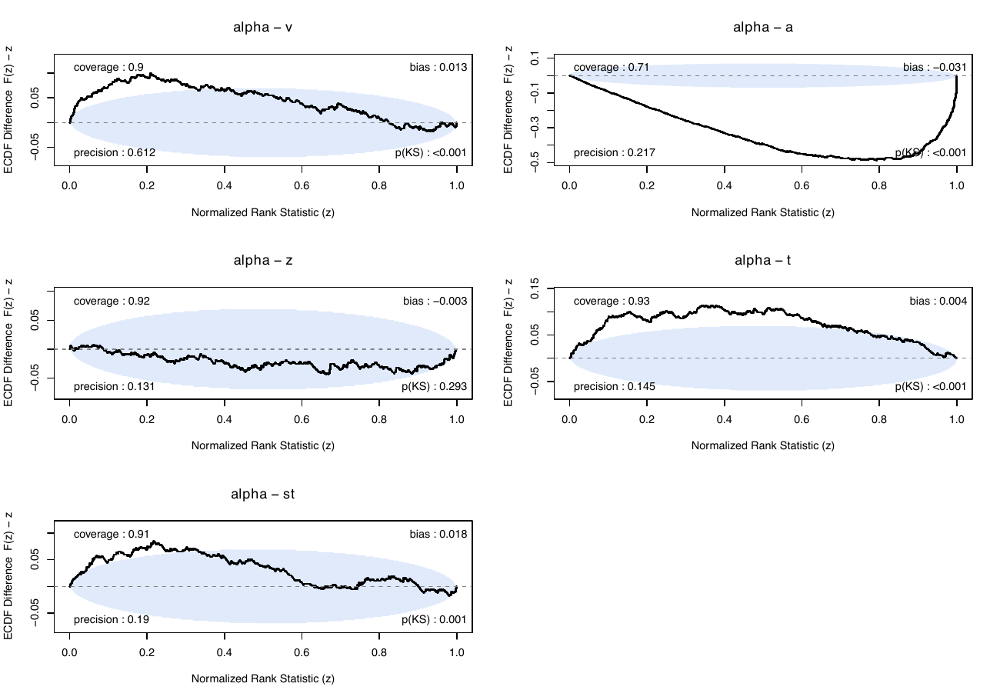{width=100%}

**Figure A1.** LAN.

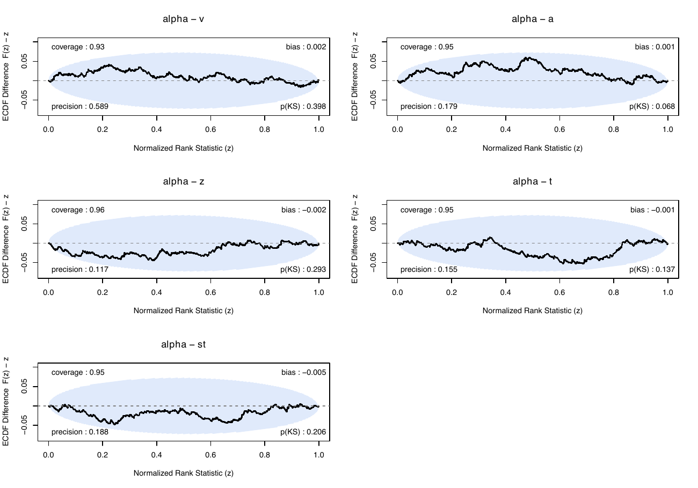{width=100%}

**Figure A2.** Analytic DDM control.

## Appendix B: SBC plots

Rank-ECDF difference plots for DDMnle, N = 400 trials, 500 replicates per model; the shaded region is the 95% envelope. Each panel gives coverage, bias, precision and the KS p-value.

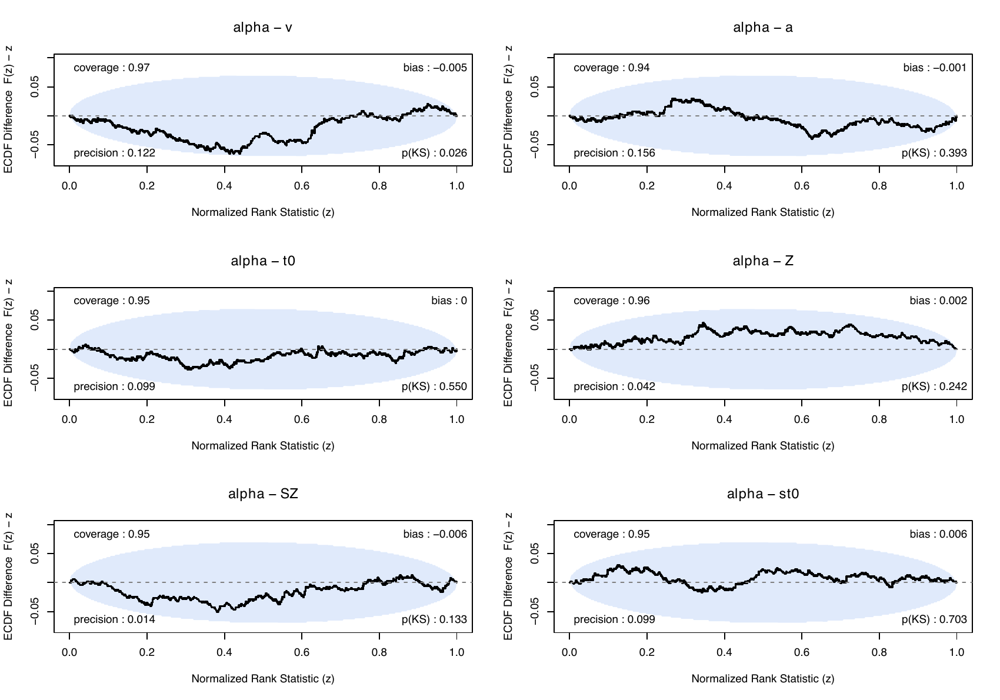{width=85%}

**Figure B1.** st0+SZ.

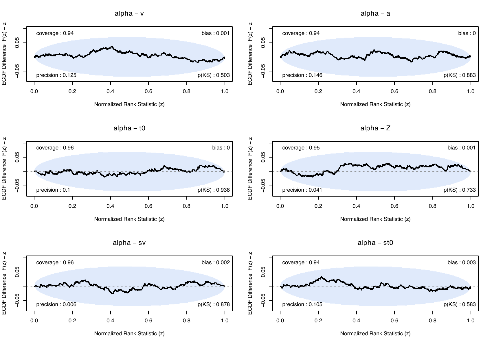{width=85%}

**Figure B2.** st0+sv.

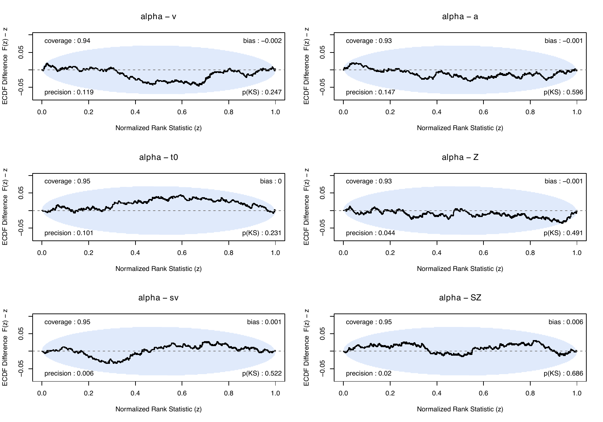{width=85%}

**Figure B3.** sv+SZ.

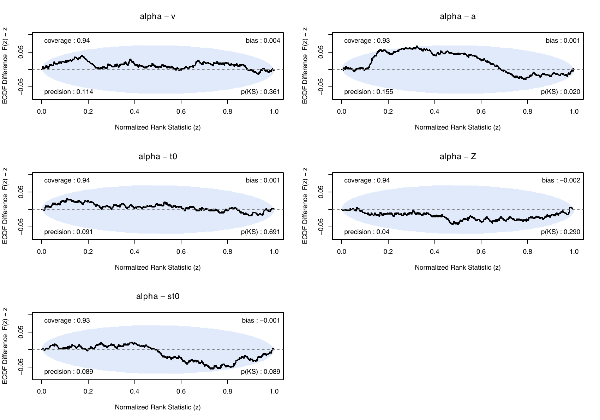{width=85%}

**Figure B4.** st0.

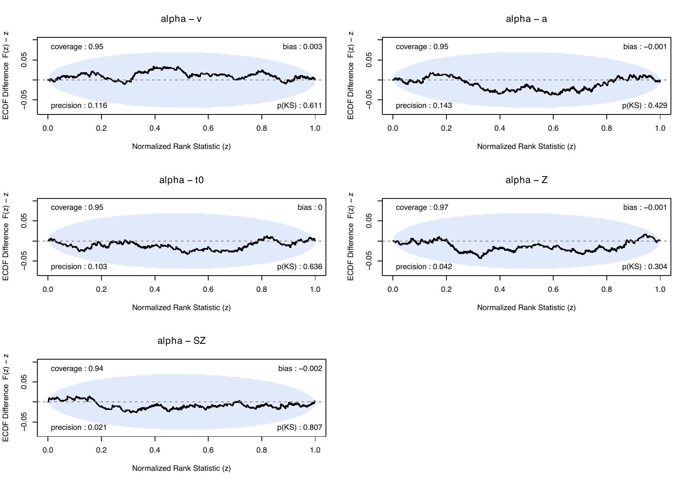{width=85%}

**Figure B5.** SZ.

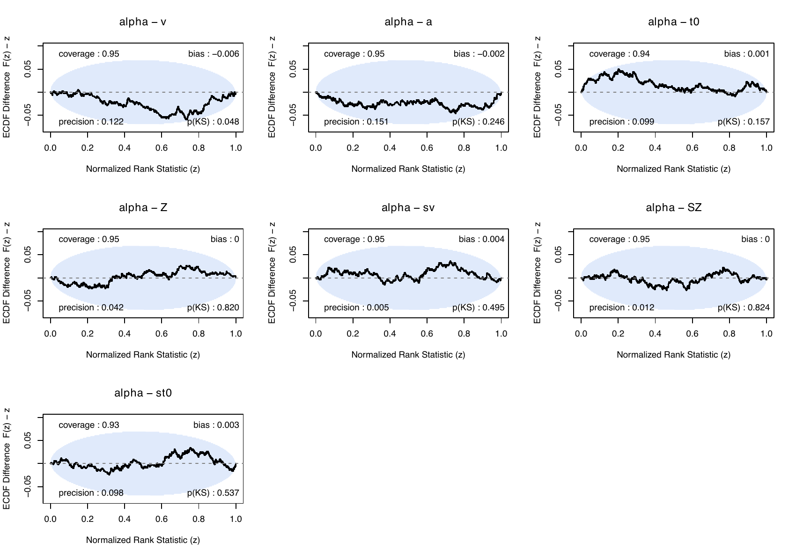{width=85%}

**Figure B6.** sv+SZ+st0.

## Appendix C: Our RDM flow, and how it compares with Malte's

### C.1 The flow

- **Model.** A conditional rational-quadratic spline flow over log rt for a single accumulator. The race
  likelihood is assembled at inference from each accumulator's flow density and survivor: L(rt, R) = f~R~(rt) · Π~j≠R~ S~j~(rt).
  For the plain RDM a closed form exists, so the flow is a demonstration of generality, not a speed gain (both flows are slower
  than the closed form).
- **Box and exact zero for A.** v ∈ [10^-3^, 5], B ∈ [0.1, 3], t0 ∈ [0.05, 1], s ∈ [0.1, 2], A ∈ [0, 2] continuous to zero. A is
  encoded as asinh(A/0.05), which is exactly 0 at A = 0, and is sampled as a mixture: 70% uniform on [0, 2], 15% uniform in the
  asinh coordinate, 15% exactly 0 (the plain Wald). Training data are 24 million rows, one trial per parameter draw.
- **Architecture and training.** [256, 128] conditioner, 64 bins, batch 1024, 300 epochs, 30 checkpoints kept per seed. Four seeds
  gave 120 checkpoints, each screened by score bias in two cells (the standard cell and the A = 0 cell); the flow with the smallest
  worst-case score bias W = max |g| over both cells was kept (W = 0.0022; the median checkpoint is 0.0139 and the quartiles are
  0.0103 and 0.0208). Selection matters: the median checkpoint is worse than Malte's flow on every measure below.

### C.2 Checks on our flow

- **Density error over A.** Between 0.0068 and 0.0118 at A from 0 to 1, against a target of at most 0.014, so it is flat in A and the
  approach to A = 0 is no longer a weak spot.
- **Score bias.** Max |g| = 0.0022 in the standard cell, no worse than the earlier flow's 0.004.
- **SBC, five cells, all clean.** A = 0 at N = 400 (250 replicates; our flow and Malte's final flow, both run), A = 0 at N = 100,
  and the standard cell at N = 100 and N = 400 (500 replicates; network and analytic control). Across the cells |standardised
  bias| ≤ 0.13 for network and control, coverage 0.92–0.98, and 2 of 40 rank ECDFs touch the envelope (one control, one network;
  KS p 0.057 and 0.052), which is the chance rate. The analytic control does it as often as the network.

### C.3 Comparison with Malte's flow

Malte's flow models decision time (t0 an exact shift) with a per-context affine stage on log time, 12 bins and a [128, 128]
conditioner, a plain Wald (no A), log(x+ε) inputs, online simulation, right-censored loss and float64. It is a single run with no
checkpoint selection. We ingest it through a converter that reproduces his evaluator to 3.6 × 10^-11^ in log density, and our
reproduction of his published density comparison agrees set by set to a KL of 2 × 10^-7^.

The comparison uses the A = 0 cell, which lies inside both boxes (s = 1), on 200 prior draws. Three measures, with the decision rule
fixed before any number was seen: density error (median KL to the reference), score bias (max |g|) and posterior shift (largest
shift in analytic posterior standard deviations).

| flow | median KL | max \|g\| | max posterior shift (sd) |
|---|---|---|---|
| Malte, final | 2.7 × 10^-5^ | 0.0043 | 0.021 |
| Malte, plain (no affine stage) | 4.4 × 10^-4^ | 0.037 | 0.431 (t0) |
| Ours, selected | 1.5 × 10^-4^ | 0.0010 | 0.041 |
| Ours, median checkpoint | 1.6 × 10^-4^ | 0.0076 | 0.113 |

- **Ours against Malte's final flow: not separated.** His density is 5.6 times closer in KL, but both flows are below the floors for
  score bias and posterior shift, and inference depends on those, not on density error. The A = 0 SBC cell at N = 400 confirms that
  both pass; the predicted difference between them (about 0.02 posterior sd) is far below what that cell can resolve (about 0.13).
- **Ours against Malte's plain flow: ours as good or better.** The plain flow cannot place mass below 6.7 ms (its spline lives on
  log t in [−5, 5] with no affine stage), so it fails whenever b/s is below about 0.2 and is poor above 3.
- **Open question.** Whether adding his affine stage to our flow improves its score bias is an arm of our seed study that has not yet
  been screened, so it is not claimed either way.

### C.4 SBC plots

Rank-ECDF difference plots for the A = 0 cell at N = 400 (250 replicates), the cell in which the two flows were compared; the shaded
region is the 95% envelope.

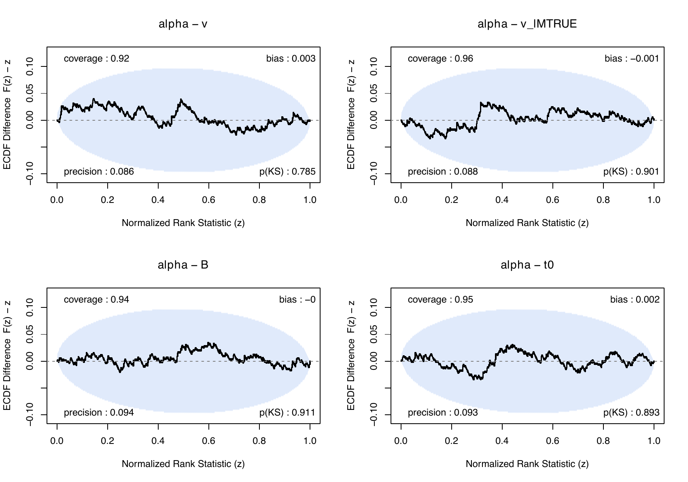{width=85%}

**Figure C1.** Our flow, A = 0 cell, N = 400.

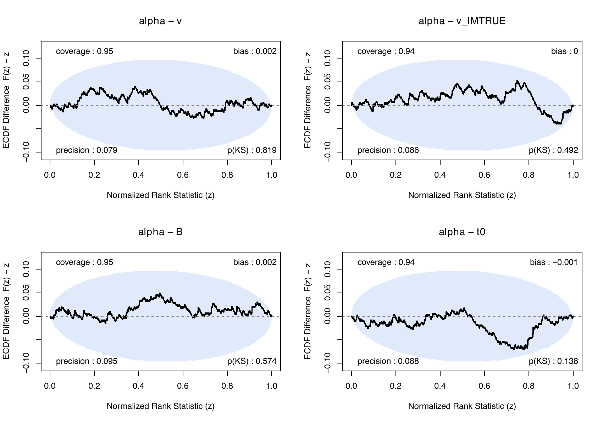{width=85%}

**Figure C2.** Malte's final flow, A = 0 cell, N = 400.

## Appendix D: The CRDM

The CRDM is the RDM with a gamma-shaped drift pulse (amplitude and time constant) on the accumulator matching a distractor, and it
is nested in the RDM at amplitude 0. It has no closed-form density: the reference is a Volterra (Fortet) integral-equation solver,
which is slow. The CRDM flow is Malte's; our work is its integration into EMC2 and its validation.

### D.1 What we built

- **A hybrid race likelihood in EMC2.** The flow supplies the density and survivor of the pulsed accumulator and the analytic Wald
  supplies the other, assembled in the compiled likelihood. Amplitude is exactly 0 outside the distractor-matched condition, so
  such trials reduce to the plain RDM.
- **A CRDM model with a reference.** A compiled simulator and a Volterra solver, shipped with EMC2 as `CRDM()`: the exact CRDM
  density and simulator, the twin of `CRDMnn()` (its parameterisation and the simulator that generates its data) and the control of
  its validation checks. `CRDM()` has no compiled likelihood, which EMC2's sampler needs, so it is not fitted; `CRDMnn()` is the CRDM
  to fit. Our solver agrees
  with Malte's to a relative error of 9 × 10^-14^ (time step 0.002) and 3.7 × 10^-13^ (0.0005); at amplitude 0 it equals the closed-form
  Wald to 4 × 10^-14^. Its convergence in the time step has order about 1.5–1.9, with a density error relative to the peak of
  5.9 × 10^-3^, 2.1 × 10^-3^ and 5.6 × 10^-4^ at steps 0.002, 0.001 and 0.0005 (against a step of 0.00025). Our simulator
  matches his draws (KS p ≥ 0.33) and the Volterra CDF (p ≥ 0.084).
- **Exact ingestion.** Our evaluator reproduces his flow's log density to 3.6 × 10^-11^, and the compiled hybrid likelihood agrees
  with an independent reference race implementation to 1.5 × 10^-13^ or better.

### D.2 Checks on the flow

- **Density.** For the flow trained against the 0.0005 reference, median KL 9.7 × 10^-5^ and KS 2.5 × 10^-3^ against that reference; at
  amplitude 0 it matches the Wald with a maximum KL of 5.4 × 10^-5^. Flows trained against coarser references inherit their error: the
  0.05 flow is poor on its own terms (median KS 0.018, maximum 0.16 here and 0.43 on his grid), and the 0.0005 reference itself has
  an error of up to 1.5 × 10^-3^ in KS.
- **SBC at N = 400, six parameters.** The hybrid network (500 replicates): |standardised bias| ≤ 0.092, coverage 0.948–0.966, all six
  rank ECDFs inside the envelope (smallest KS p 0.063). The Volterra analytic control at step 0.002 (250 replicates): ≤ 0.153,
  coverage 0.944–0.972, all inside. At step 0.0005 (50 replicates): ≤ 0.156, coverage 0.94–0.98, one ECDF (amplitude) outside the
  envelope, accepted as chance (1 of 18 control cells; the network and the 0.002 control are clean on it). Network against each
  control: no disagreement beyond chance (smallest p 0.114 and 0.075, Bonferroni over 18 tests).
- **Posterior shift against the reference** (200 datasets, the largest shift in analytic posterior sd): 0.017 for the 0.0005 flow,
  below the 0.10 floor, so it passes; 0.117 for the 0.005 flow, narrowly over; 0.59 for the 0.05 flow, which fails.
- **Speed.** On 400 trials with responses up to 2.3 s, one likelihood evaluation takes 0.17 ms with the flow, 4.1 ms with EMC2's
  Volterra solver at step 0.002 and 61 ms at step 0.0005 (one thread), so the flow is about 24 and 360 times faster. The solver's cost
  grows with the square of the longest decision time, so the gap widens with slower responses. In the SBC runs a Volterra cell took
  2.7 h (step 0.002, 250 replicates) and 8.5 h (0.0005, 50 replicates) on 48 cores, against 22 minutes for the 500-replicate network
  cell.
- **Verdict.** The hybrid network with the 0.0005 flow passes SBC at N = 400 and is indistinguishable from the Volterra reference at
  both resolutions. It ships with EMC2 as `CRDMnn()`; the 0.005 and 0.05 flows, which failed the posterior-shift check, do not.
- **Limit.** The score-bias screen cannot yet resolve amplitude: its analytic control is 0.021 on that parameter, 21 times its
  floor, so the screen cannot separate flow bias from solver noise there. The posterior-shift and SBC measures are unaffected.

### D.3 SBC plots

Rank-ECDF difference plots at N = 400; the shaded region is the 95% envelope.

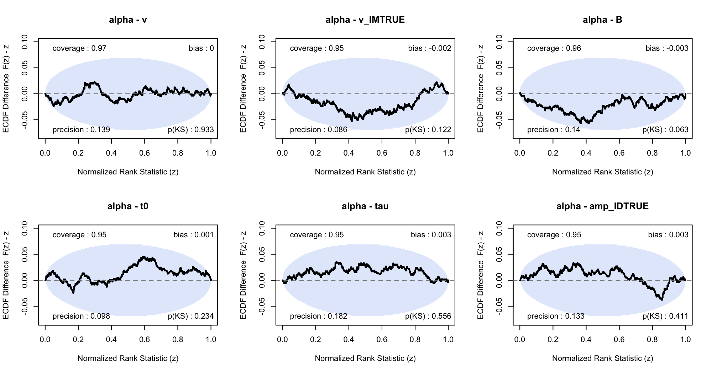{width=100%}

**Figure D1.** Hybrid network, 500 replicates.

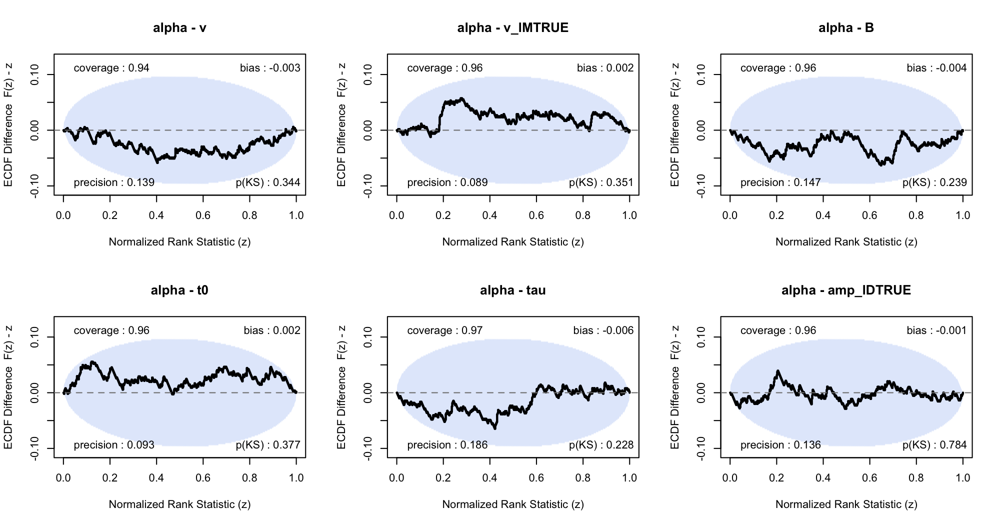{width=100%}

**Figure D2.** Volterra analytic control, step 0.002, 250 replicates.

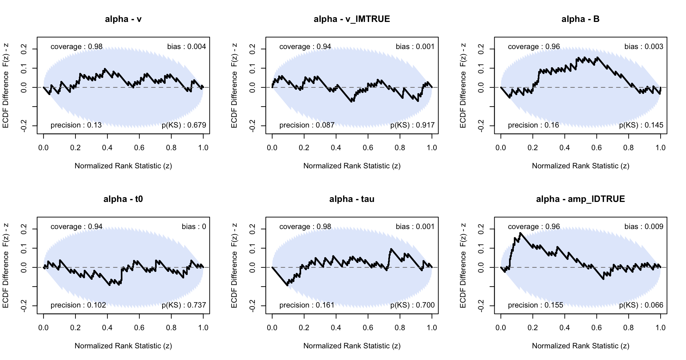{width=100%}

**Figure D3.** Volterra analytic control, step 0.0005, 50 replicates (amplitude is the parameter at the envelope edge).
